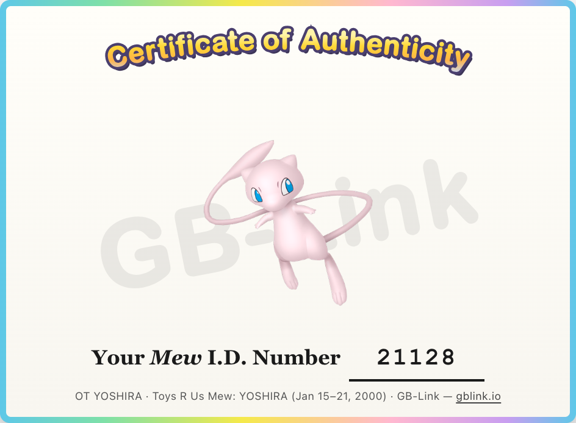

# GB-Link Distributor

Trade any Pokémon from your party for a historical event Pokémon on a real Game Boy (Pokémon Red, Blue, Yellow, Gold, Silver, Crystal, Ruby, Sapphire, Emerald, FireRed, or LeafGreen), over a link cable and a [GB-Link USB adapter](https://gblink.io).

Nothing is injected into your save file — the event Pokémon arrives through a normal in-game trade at the Cable Club.

**Live demo:** [distribution.gblink.io](https://distribution.gblink.io)

## Requirements

- Chrome or Edge (WebUSB), or Firefox 151+ (WebSerial)
- [GB-Link USB adapter](https://gblink.io)
- Game Boy link cable
- Pokémon Red, Blue, Yellow, Gold, Silver, Crystal, Ruby, Sapphire, Emerald, FireRed, or LeafGreen cartridge

## Run

```bash
npm install
npm run dev
```

Open the HTTPS URL Vite prints (e.g. `https://localhost:5173`), pick an event, click **Connect Game Boy**, then on the handheld: enter **Cable Club** and talk to the clerk — the trade room loads automatically.

## Flash carts

Official cartridges save normally after a trade. Flash carts often need an extra step to write the trade to the cart’s save file.

After the trade completes and the Certificate of Authenticity appears, on your Game Boy:

1. Press **Cancel** to leave the link session
2. Open the **Start** menu
3. Select **Exit**
4. Choose **Reset**, then **Continue** from the main menu
5. **Save** your game

## Certificate of Authenticity

When a trade finishes successfully and the Game Boy is back at the Pokémon select screen, the app shows a **Certificate of Authenticity** below the status panel.



Each certificate records the distribution event, species, original trainer name, and the trainer ID used for that trade. You can download it as a PNG with **Download image**.

## Adding events

1. Add `src/events/<region>/my_event.js` (copy an existing event file and edit fields).
2. Add its path to `src/events/manifest.json` (order in the list is the dropdown order).
3. Run `npm run events:sync` or restart the dev server — events are bundled into `registry.js` automatically on build/dev start.

Stat encoding, IV packing, and trade packet layout are handled automatically.

## TODO

- Localized game support (Japan first; other regions TBD)
- Gen 2 Time Capsule support

## Credits

- [PokeAPI](https://pokeapi.co/) — Pokémon Home sprites bundled for the distribution catalog and trade certificate
- [risingPhil/PokeMe64](https://github.com/risingPhil/PokeMe64) — reference data for historical distribution event Pokémon
- [GrenderG/mewdistro](https://github.com/GrenderG/mewdistro) — Gen 1 party block layout and Mew distribution trade flow
- [GrenderG/celebidistro](https://github.com/GrenderG/celebidistro) — Gen 2 Celebi distribution trade flow and party data layout
- [Lorenzooone/PokemonGB_Online_Trades](https://github.com/Lorenzooone/PokemonGB_Online_Trades) — Cable Club link protocol and automated Trade Center entry
- [pret/pokeruby](https://github.com/pret/pokeruby), [pret/pokeemerald](https://github.com/pret/pokeemerald), [pret/pokefirered](https://github.com/pret/pokefirered) — Gen 3 Cable Club and trade protocol reference
